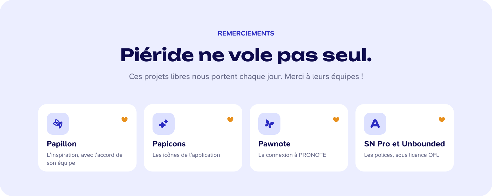
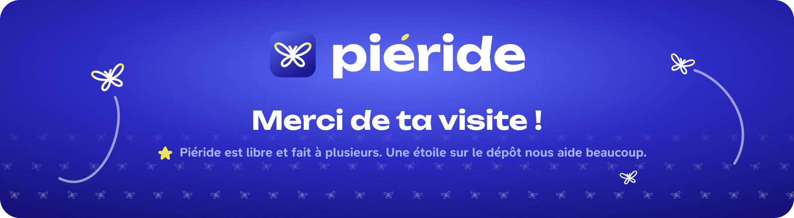

  
  

  

  L'application de bureau libre et open source pour ta vie scolaire.

  <!--  -->
  

> Piéride est en cours de développement : il n'y a pas encore de version à télécharger, et les aperçus ci-dessous viennent des maquettes.

 

  

  

  

  

## Remerciements

  

- [Papillon](https://github.com/PapillonApp/Papillon) : Piéride s'en inspire, avec l'accord de son équipe.
- [Papicons](https://github.com/PapillonApp/Papicons) : les icônes de l'application.
- [Pawnote](https://www.npmjs.com/package/@blockshub/pawnote-lts) : la connexion à PRONOTE.
- Les polices [SN Pro](https://github.com/supernotes/sn-pro) et [Unbounded](https://github.com/googlefonts/unbounded), sous licence [OFL](https://openfontlicense.org).

  

